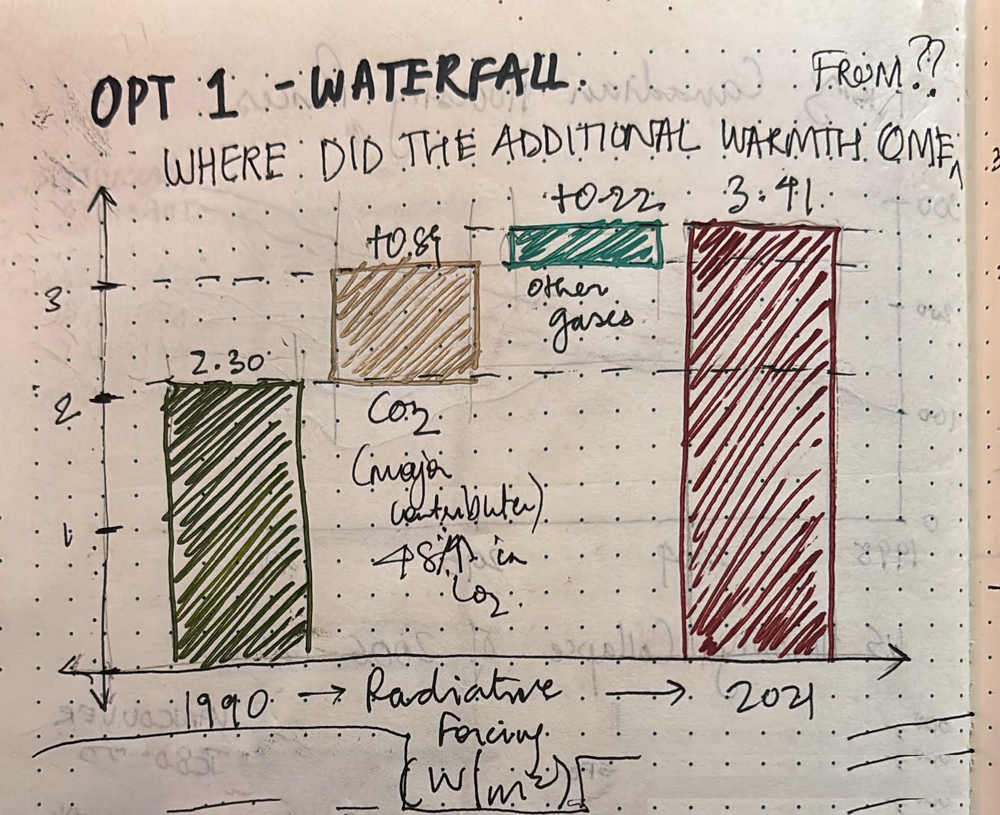
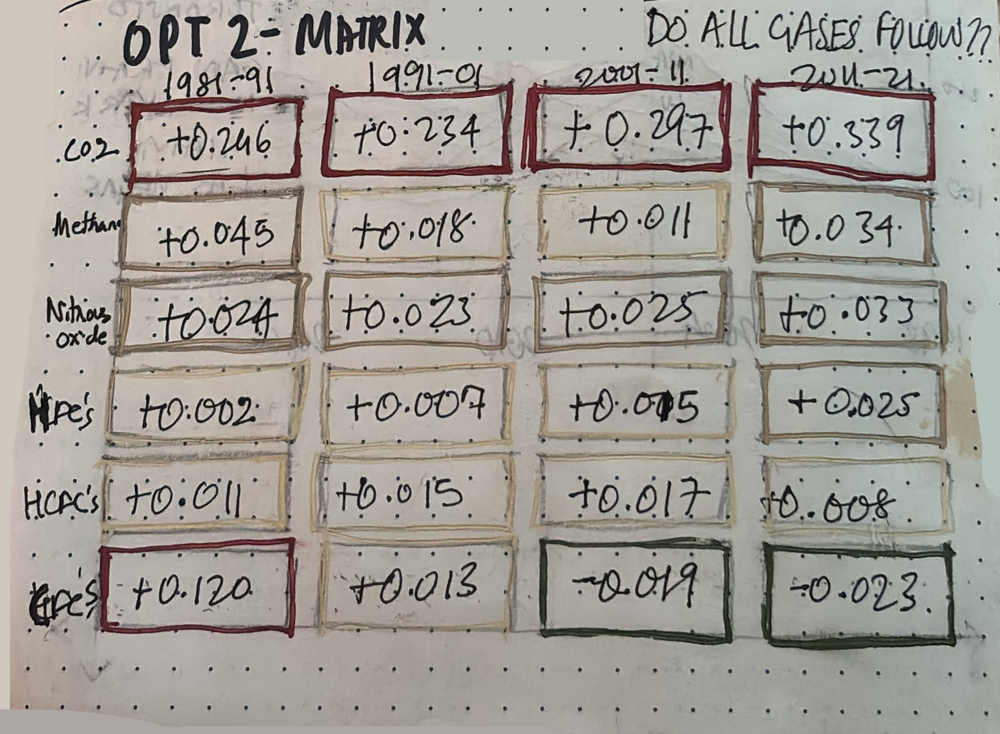
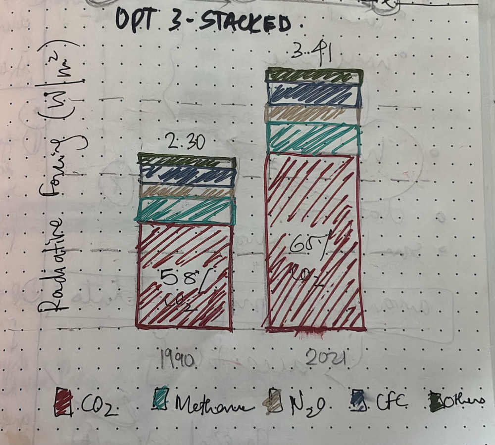

| [Home Page](https://marxcel2412.github.io/yash_tellingstories_portfolio/) | [Data Viz Examples](dataviz-examples) | [Viz Gov Debt](visualizing-government-debt) | [Critique By Design](critique-by-design) | [Final Project I](final-project-part-one) | [Final Project II](final-project-part-two) | [Final Project III](final-project-part-three) |

# Critique by Design: CO₂ Kept Rising. CFCs Reversed Course.

**MakeoverMonday 2023, Week 1 · NOAA Annual Greenhouse Gas Index · Critique, sketching, peer feedback and Tableau redesign**

*How can a scientific chart move beyond showing that greenhouse-gas warming influence is rising, and help readers discover which gases changed, when, and why those differences matter?*

---

## Step one: Selecting the visualization

**Original visualization:** [NOAA Annual Greenhouse Gas Index (AGGI)](https://gml.noaa.gov/aggi/aggi.html)  
**2023 MakeoverMonday challenge:** [Week 1 — The Change in Greenhouse Gases in the Atmosphere](https://www.vizwiz.com/2023/01/greenhouse-gases.html)

*Original NOAA chart, as reproduced in the MakeoverMonday 2023 Week 1 discussion. Credit: NOAA Global Monitoring Laboratory; image linked from the challenge archive.*

I chose NOAA's Annual Greenhouse Gas Index because climate data is important to my interests in sustainability and building performance, and because the chart illustrates a familiar challenge: scientific information can be technically rigorous without immediately telling a clear story to someone outside the field. The original combines CO₂, CO₂-equivalent greenhouse-gas concentration, and the AGGI into an extended historical view.

I wanted to explore whether a redesign could help people understand something **beyond the general upward trend**. The challenge was to keep the science honest while making the relationships between gases easier to compare. The original MakeoverMonday task used the 1979–2021 data context; the public NOAA page has since been updated, so my calculations use one consistently sourced historical series and stop at 2021.

## Step two: Critiquing the original

I used **Stephen Few's Data Visualization Effectiveness Profile** and submitted the course critique form. The scores below summarize my evaluation of the original chart, on a 1–10 scale.

| Criterion | Rating | My reasoning |
|:--|:--:|:--|
| Usefulness | **8** | Its long-term measurements are valuable for climate communication and policy discussion. |
| Completeness | **6** | It includes several measures and historical context, but their relationships and reference points could be explained more directly. |
| Perceptibility | **5** | Overlapping lines, a long time scale and two vertical axes make comparisons laborious. |
| Truthfulness | **8** | NOAA is an authoritative source; the challenge is possible misinterpretation of differently scaled measures, not evidence that the underlying data are false. |
| Intuitiveness | **5** | The upward trend is clear, but the AGGI and its 1990 reference need explanation for new readers. |
| Aesthetics | **6** | The graphic is restrained and functional, but the legend, gridlines and lines compete for attention. |
| Engagement | **6** | Its topic matters, yet the chart does not immediately foreground an interpretable takeaway. |

**What worked:** A time series is an appropriate way to show historical change, the scientific source is credible, and the distinction between CO₂ and other long-lived gases is valuable.

**What I wanted to improve:** The original uses different units and a secondary axis. Readers can follow the rising curves, but it takes more work to determine *what is responsible* for the increase and how different gas groups behaved. I wanted one consistent measurement, clearer comparisons, and a title that gives readers a question or finding.

**Reflecting on the critique method:** Few's framework helped me distinguish scientific credibility from clarity and usefulness. Compared with *Good Charts*, it felt more diagnostic: it identifies particular problems. *Good Charts* contributed the complementary questions of intended audience, central message, and what a reader should take away. Scores alone cannot capture all of that context.

## Step three: Sketching three alternatives

Before building the final redesign in Tableau, I explored **three different chart types** to see how the same NOAA dataset could tell different stories. I wanted more than a cleaner version of the original lines: I wanted the form of each visualization to help answer a different question.

### Concept A — Contribution waterfall: *Where did the additional warming influence come from?*

*Sketch 1. Waterfall concept: from approximately 2.30 W/m² in 1990 to 3.41 W/m² in 2021, decomposing the intervening increase into CO₂ and other greenhouse-gas contributions. Hand-drawn exploratory sketch.*

My first sketch begins with the **1990 total radiative forcing**, adds the increment associated with **CO₂** and then the combined increment from **other gases**, and ends at the higher **2021 total**. All quantities use W/m². The step-by-step structure was intended to make the magnitude of CO₂'s contribution apparent at a glance.

The strength of the waterfall is its **story of attribution**: where the increase came from. Its limitation is that it compresses more than thirty years into two endpoints, obscuring when the different gas groups accelerated, slowed, or reversed direction.

### Concept B — Decadal matrix: *Did all gases follow the same path?*

*Sketch 2. Matrix concept: change in radiative forcing (W/m²) for six gas groups over four decades. Contrasting outlines anticipate the final design's warm colors for increases and cool colors for decreases. Hand-drawn exploratory sketch.*

The second sketch arranges **greenhouse gases in rows and four ten-year intervals in columns**: 1981–1991, 1991–2001, 2001–2011 and 2011–2021. Each cell contains the change in radiative forcing for that gas during the decade. I used contrasting colored outlines to emphasize the direction of change, while preserving the actual numbers.

This design supported two kinds of reading: **across a row**, to follow how a gas changed over time, and **down a column**, to compare gases within the same decade. Most importantly, it drew attention to a distinctive contrast: CO₂-related forcing increased in every interval, whereas CFC-related forcing decreased in the later intervals. Unlike the original NOAA figure, these patterns do not require following several overlapping lines.

### Concept C — Stacked columns: *How did the total and composition change?*

*Sketch 3. Stacked-column concept: compare the total radiative forcing and relative contributions of major greenhouse-gas groups in 1990 and 2021. Hand-drawn exploratory sketch.*

The third sketch uses **two stacked columns**, one for **1990** and one for **2021**. Each colored segment represents a gas group, so the column height communicates **total radiative forcing**, while the segments communicate **part-to-whole composition**. I emphasized the CO₂ segment to investigate how its contribution changed relative to the total: approximately **58% in 1990** versus **65% in 2021** in the revised NOAA historical data.

This approach makes two findings visible simultaneously: the overall forcing was higher in 2021, and **CO₂ occupied a larger proportion of the total**. Its limitation is that a two-column comparison cannot show when individual gas groups changed direction. It also makes smaller gas segments harder to compare precisely than the matrix.

### What the three sketches taught me

| Sketch | Central question | What it reveals | What it leaves out |
|:--|:--|:--|:--|
| **Waterfall** | Where did the increase come from? | The contribution of CO₂ versus other gases to the overall change | The sequence and timing of changes |
| **Decadal matrix** | Did all gases follow the same path? | Differences in direction and pace across four decades | The continuous year-by-year trajectory |
| **Stacked columns** | How did the total and its composition change? | Both the overall increase and CO₂'s growing share | Changes between the two endpoints |

The sketches showed me that **chart selection changes the question a reader can answer**, not merely the appearance of the same dataset. I brought these alternatives into classroom discussion and ultimately chose the matrix as the basis for my final Tableau redesign.

## Step four: Testing the sketches

I discussed the concepts with three classmates: **a first-year MISM student, a second-year MISM student, and a second-year MSPPM-DA student**. I have not included names or identifying details.

The common preference was for the **matrix**. The group appreciated that it revealed opposing movements in a simple structure rather than asking readers to trace multiple curves. The discussion also made clear that a readable matrix alone was not enough: the graphic needed a stronger headline and context explaining the gas categories.

| Classroom feedback | What I changed in response |
|:--|:--|
| The matrix was the preferred approach among the three sketches. | I retained it as the central chart. |
| The contrast between increases and decreases was particularly effective. | I preserved a diverging warm/cool color language and kept the numeric values visible. |
| The title could explain the story better. | I moved to a finding-led headline about CO₂ and CFCs. |
| A final column should combine the four decades. | I added a **1981–2021 net-change comparison** and developed it into companion bars so the overall magnitudes are easier to compare. |
| Readers needed an explanation for the CFC decline. | I added an explanatory note about the Montreal Protocol and CFC phaseouts. |
| Readers needed to know where these gases come from. | I added concise context on the common human activities associated with each gas group. |

The feedback shifted my focus from simply making the matrix attractive to giving it **layers of interpretation**: the decade-by-decade values, the 40-year comparison, and short explanations that connect the measurements to familiar activities and policy.

## Step five: Building the final Tableau redesign

### CO₂ Kept Rising. CFCs Reversed Course.

The final Tableau dashboard combines a **decadal matrix** with **40-year net-change bars**, supported by source descriptions and an annotation explaining the later decline in CFC-related forcing.

<!-- The Tableau workbook has a fixed 1400 × 1177 desktop layout.
     Scale the entire iframe to the reader's available width instead of
     clipping the right-hand chart. The view remains interactive. -->

  <iframe
    id="noaa-viz-iframe"
    src="https://public.tableau.com/views/GreenhouseGasDecadalMatrix/Dashboard1?:showVizHome=no&amp;:embed=true&amp;:toolbar=no"
    width="1400"
    height="1177"
    style="width: 1400px; height: 1177px; border: 0; display: block; transform-origin: top left;"
    loading="lazy"
    allowfullscreen
    title="Interactive NOAA greenhouse gas decadal matrix with 40-year net-change bars">
  </iframe>

[**Open the full interactive dashboard on Tableau Public**](https://public.tableau.com/views/GreenhouseGasDecadalMatrix/Dashboard1)

### What the redesign shows

The matrix makes it easy to compare **changes in warming influence**, rather than compare values read from two unrelated axes. In the historical data used for the redesign, CO₂'s forcing increased in every decade and has the largest net change over 1981–2021 (approximately **+1.116 W/m²**). CFC-related forcing, however, turned negative in the 2001–2011 and 2011–2021 change intervals. Its **net change across all four decades is still positive**, an important distinction from claiming that CFC-related forcing fell over the entire period.

The companion bars establish a second reading of the data: which gases contributed most over the full 40 years. The combined total is approximately **+1.520 W/m²**. The total represents the component gas groups together; it is not a seventh contributing gas and should not be added to the other rows.

### Why I made these design decisions

- **A matrix instead of overlapping lines:** Each gas and decade has its own cell. The structure reveals differences in direction and pace without a dual axis.
- **Color plus numbers:** Warm colors identify increases and cool colors identify decreases; numeric labels preserve precise comparisons and help readers who cannot rely on color alone.
- **A companion net-change bar chart:** The matrix explains *when* changes occurred, while bar length explains *how much* each group changed overall.
- **Context outside the main chart:** Short notes explain human sources of gases and the CFC reversal without overcrowding the measurements.

The Montreal Protocol was agreed in 1987 and established controls on ozone-depleting substances. That history helps interpret the later decline in CFC-related forcing, but the matrix itself should not be read as a causal estimate of how much radiative forcing the policy prevented.

### What I learned

My initial inclination was to simplify NOAA's original figure by splitting up the existing lines. Critique and sketching pushed me toward a more useful change: **asking a different question of the same underlying data**. Peer feedback then showed the value of pairing a concise chart with just enough context for a wider audience. The final design trades the precision of a continuous annual timeline for clearer decade-level comparisons and gas-specific interpretation. That trade-off is intentional.

### Methodological note

The data are **changes in radiative forcing, measured in W/m²**, not emissions, atmospheric concentration, or degrees of warming. Each decade is calculated as the ending year's value minus the starting year's value; the net comparison is 2021 minus 1981. The historical values are based on NOAA's **revised AGGI series** and may differ from numbers presented with the original 2023 MakeoverMonday challenge. The label “CFCs and related gases” follows NOAA's grouped classification; the group can contain related compounds.

## References

1. NOAA Global Monitoring Laboratory. [Annual Greenhouse Gas Index (AGGI)](https://gml.noaa.gov/aggi/aggi.html). Original data and revised historical radiative-forcing series.
2. MakeoverMonday, 2023 Week 1. [The Change in Greenhouse Gases in the Atmosphere](https://www.vizwiz.com/2023/01/greenhouse-gases.html). Source of the original challenge and chart reproduction.
3. Few, Stephen (2017). [Data Visualization Effectiveness Profile](https://www.perceptualedge.com/articles/visual_business_intelligence/data_visualization_effectiveness_profile.pdf). Perceptual Edge.
4. Berinato, Scott. *Good Charts*, Chapters 3–4. Harvard Business Review Press.
5. United Nations Environment Programme, Ozone Secretariat. [Montreal Protocol on Substances that Deplete the Ozone Layer](https://ozone.unep.org/treaties/montreal-protocol).
6. U.S. Environmental Protection Agency. [Overview of Greenhouse Gases](https://www.epa.gov/ghgemissions/overview-greenhouse-gases). Background on common sources.

## AI acknowledgement

I used **ChatGPT (OpenAI)** to brainstorm contrasting visualization concepts, inspect and organize NOAA's historical data, prepare Tableau-ready calculations, and troubleshoot Tableau formatting and dashboard construction. I made the design decisions, developed and discussed the sketches in class, gathered feedback from classmates, and built the final Tableau dashboard. ChatGPT also assisted with the errors in the GitHub page update, such as fitting the dashboard horizontally.

---

[← Back to portfolio home](https://marxcel2412.github.io/yash_tellingstories_portfolio/)
