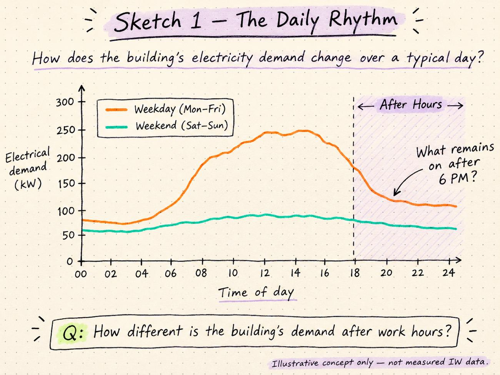
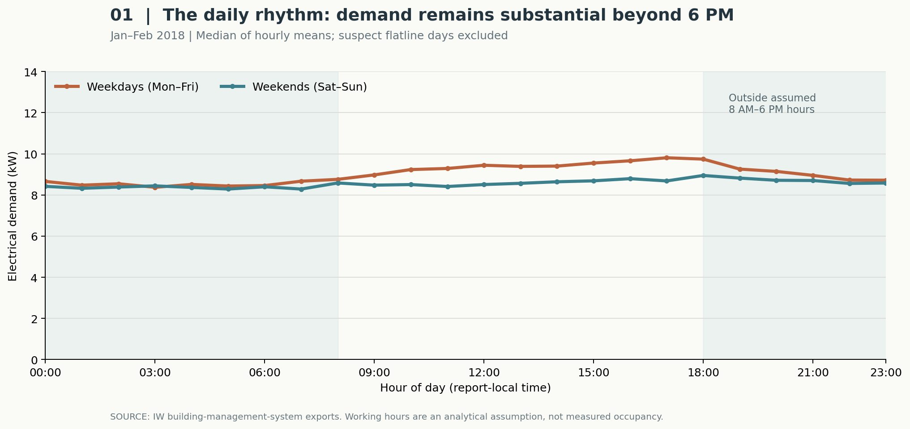
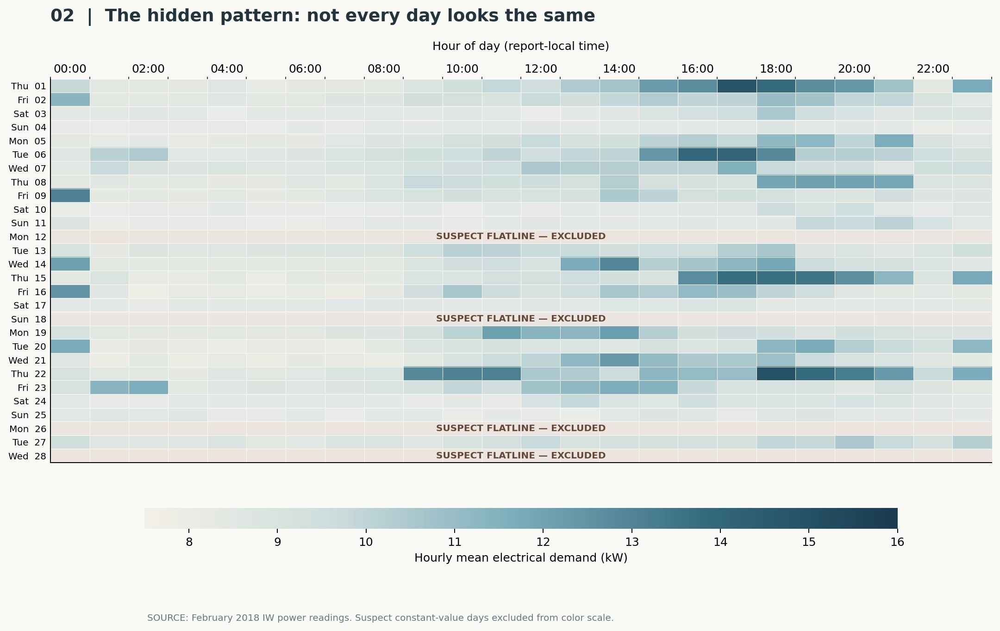
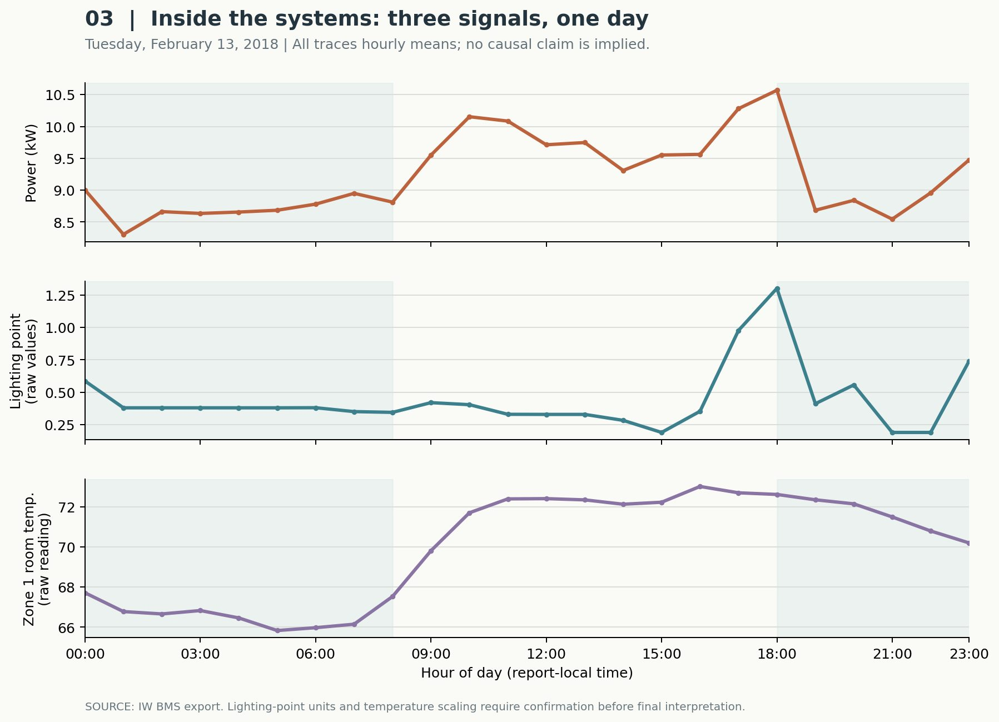

| [Home Page](https://marxcel2412.github.io/yash_tellingstories_portfolio/) | [Data Viz Examples](dataviz-examples) | [Viz Gov Debt](visualizing-government-debt) | [Critique By Design](critique-by-design) | [Final Project I](final-project-part-one) | [Final Project II](final-project-part-two) | [Final Project III](final-project-part-three) |

# After Hours: Does an Intelligent Building Ever Switch Off?

**Final Project — Part I | Telling Stories with Data**

*Tracing energy demand and environmental behavior at Carnegie Mellon University's Robert L. Preger Intelligent Workplace (IW).*

> **Status:** Initial proposal and preliminary evidence. The preliminary plots below use real data, but they are exploratory; the project's conclusions have not been established.

## Outline

### High-level overview

Buildings are increasingly designed and described as intelligent, responsive, and energy-efficient. Yet a building's intelligence is not apparent simply because it has sensors or advanced controls: its operating patterns need to be examined. I want to investigate how electrical demand at the **Robert L. Preger Intelligent Workplace (IW)** changes throughout the day, particularly when a conventional workday ends. I am interested in the contrast between how we imagine an office building operates and what its measured demand actually does.

My project uses historical IW building-management-system exports, supplied with permission, to examine recorded electricity demand alongside selected lighting and indoor environmental measurements. I will start with January and February 2018 because two complete five-minute reports could be recovered and verified. The goal is **not** to declare nighttime energy demand wasteful or to measure the building's overall efficiency from a single meter. As a research-oriented building, the IW may have legitimate after-hours loads. Instead, I hope to explore how much demand persists, whether patterns repeat, and which available measurements can help explain them.

### Central question

**How does the Intelligent Workplace's electrical demand vary across assumed working and nonworking periods, and what can its recorded systems and indoor conditions reveal about that behavior?**

**Target audience:** Architecture and sustainability students, building operators, and a broader audience curious about how an intelligent building actually operates.

**One-sentence aim:** A building's operational intelligence cannot be judged from its energy use alone; the timing, context, and purposes of its demand also matter.

### Proposed narrative structure

| Act | Story beat | Question guiding the reader | Proposed storytelling element |
|:--|:--|:--|:--|
| **I — The promise** | Introduce the IW as a living laboratory and establish expectations of responsiveness. | What do we expect an intelligent building to do? | Architectural introduction and simplified systems diagram |
| **II — A daily rhythm** | Compare typical weekday and weekend electrical-demand profiles. | Does demand drop when the conventional workday ends? | A 24-hour annotated profile |
| **III — Behind the average** | Show repeated patterns and exceptions day by day. | Is the daily profile consistent, or do some days behave differently? | A February date-by-hour heatmap |
| **IV — Inside the systems** | Examine synchronized demand, lighting and indoor-condition readings. | Which signals change together, and what remains unexplained? | Aligned time-series panels |
| **V — Interpreting intelligence** | Distinguish what is measured from what requires operational knowledge. | What could this tell us about operating schedules, necessary loads, and future investigation? | Evidence-based conclusion and limitations |

The story will move from **expectation → measurement → exception → investigation → interpretation**, with its final message refined after analysis rather than assumed in advance.

## Initial sketches

These three exploratory sketch images are **AI-assisted visual representations of my planned chart layouts**, not visualizations of recorded IW values. Their numerical scales and lines are illustrative. Each develops a different chapter of the same story.

### Sketch 1 — The daily rhythm

*Figure 1. A two-line 24-hour demand profile, with the period after 6 PM highlighted. The purpose is to make the expected weekday/weekend contrast and any persistent background load directly comparable.*

**Why this chart?** A typical-day profile is a natural entry point for nonspecialists. It reveals *when* demand changes without requiring readers to inspect thousands of individual readings. The planned comparison uses the median of hourly demand within weekdays and weekends, not a single arbitrary day. The nominal 8 AM–6 PM window is an **analytical assumption**, not verified occupancy.

### Sketch 2 — The hidden pattern

*Figure 2. A date-by-hour heatmap using color to represent demand. In the final version, rows will be actual dates in a chosen month, rather than the seven representative day-of-week rows shown in this early sketch.*

**Why this chart?** Averaged demand profiles can conceal irregular days. The heatmap lets readers distinguish recurring patterns, weekends, and anomalous periods. It also provides a reason to discuss data quality when meter readings appear unnaturally constant.

### Sketch 3 — Inside the systems

*Figure 3. Aligned energy, environmental and system signals sharing the same time axis. This is a relationship-investigation sketch, not proof that any one system causes changes in total demand.*

**Why this chart?** The project should move beyond reporting consumption to examine the building's operation. Aligning time axes helps a reader ask whether lighting or indoor environmental measurements change alongside demand. I will select only sensors with verifiable readings and avoid inferring causality from correlations.

## Initial data exploration: what the measurements actually suggest

The three figures below are **first-pass analyses of measured IW records**, not the original sketches or finalized graphics. They are included now to show that the proposed story can be developed from the available dataset.

### Finding A — A persistent electrical baseline

*Preliminary Chart A. Median of each hour's mean demand across weekdays versus weekends in January–February 2018, excluding five suspect meter-flatline dates. Power readings come from the point labeled “All Instant kW.”*

Under an assumed weekday business window of **8 AM–6 PM**, median demand was approximately **9.11 kW during working hours versus 8.67 kW outside them in January**, and **9.57 kW versus 8.68 kW in February**, after excluding suspicious flatline days. The modest differences invite further investigation, but do not establish actual occupancy, the types of load served by the meter, or inefficiency.

### Finding B — Some days do not follow the expected pattern

*Preliminary Chart B. Hourly mean demand for each day of February 2018. Pale flagged rows represent dates excluded from the color comparison because the meter was nearly constant throughout the day.*

This chart reveals variability hidden by the typical profile. Some days show concentrated higher demand during afternoon hours, while others appear comparatively steady. Five dates across the two-month sample were flagged for **two or fewer distinct power values over a full day**; the flag is a precaution, not a definitive diagnosis of a faulty sensor.

### Finding C — A first look at coincident signals

*Preliminary Chart C. A representative day, February 13, 2018, aligning hourly mean electrical demand, the “All_Lighting_Cons” point, and one zone's “RMT” room-temperature reading. The latter two are intentionally labeled as raw values because their units and sensor interpretations still need confirmation.*

This early comparison illustrates the analytical opportunity without claiming that lighting or temperature explains power demand. The third act of the story will need additional checks against sensor documentation, weather, and any available operating schedules.

## The data

### Data provenance and selected scope

The source is a user-supplied collection of historical building-management-system exports from **CMU's Intelligent Workplace**, used with permission for this course project. These reports contain approximately 250 labeled monitoring points, including electrical demand, lighting-related values, indoor CO₂ and humidity, zone-temperature readings, and building-system controls. I am not using named occupant-comfort or voting fields.

The source archive is **truncated** and cannot be opened as a conventional complete ZIP. However, the individual monthly CSV reports used here were recovered intact. Report filenames indicate an export/report period and **do not identify the month of the readings reliably**: the internal `Date Range` header is authoritative. Specifically, the report named `02-01-18` contains **January 2018** data and the report named `03-01-18` contains **February 2018** data.

### Public, cleaned dataset

**[Download the hourly Tableau-ready IW dataset (January–February 2018)](data/IW_public_hourly_Jan_Feb_2018.csv)**

[View the dataset directly on GitHub](https://github.com/marxcel2412/yash_tellingstories_portfolio/blob/main/data/IW_public_hourly_Jan_Feb_2018.csv)

| Property | Details |
|:--|:--|
| Period covered | January 1–February 28, 2018, inclusive |
| Source frequency | Every 5 minutes |
| Exported dataset | **1,416 hourly records**, representing 16,992 five-minute timestamps |
| Primary variable | `Power_kW_hourly_mean` from `All Instant kW` |
| Additional variables | Hourly mean raw lighting, Zone 1 CO₂, relative humidity and room-temperature readings |
| Metadata | Timestamp, month, date, hour, day of week, weekday/weekend, assumed work-hour flag |
| Quality-control information | Number of contributing power observations per hour and `Power_QA_Flag` |
| Data scope | Selected measurements only; personal comfort-vote fields are omitted |

This dataset is the working copy for initial Tableau analysis. For reproducibility, each hourly demand value averages **twelve five-minute readings** when all observations are available. Missing or nonnumeric values become blank rather than zero. The reported time strings have no explicit UTC offset, so they are retained as **report-local timestamps**, without an assumed time-zone conversion.

### Data quality, analytical assumptions, and limitations

I validated that January had **8,928** evenly spaced readings and February had **8,064**, with no missing numeric readings for the selected power point. One February zone-temperature observation contained the error string `TIME (-2)` and is blank in the cleaned series. Five days — **January 22 and February 12, 18, 26 and 28** — had two or fewer distinct power readings across their day and were flagged as suspected reporting flatlines. The public data **retains** those records with an explicit QA flag; the preliminary power visualizations and period medians **exclude** flagged dates.

Other sensor limitations remain. The point `All_Lighting_Cons` has not yet been verified as a particular physical unit, and some zone-temperature values look Fahrenheit-like but lack confirmed sensor documentation. Other system signals such as heating or cooling modes may be categorical states, not numeric readings. I therefore avoid assigning physical units to unverified channels or treating every sensor as directly comparable.

Finally, the analysis **does not include verified building occupancy, weather normalization, an energy end-use inventory or confirmed meter boundaries**. No after-hours power reading alone proves waste. The eventual story will distinguish observations from hypotheses and should be reviewed against IW building-system documentation before drawing operational conclusions.

## Method and medium

The final deliverable will be an **interactive, narrative data story**, rather than a standalone dashboard. I plan to use **Tableau** for preparing the visualizations and **Shorthand** for an article-style reading experience with a clear progression, annotation and transitions between views. I will use this GitHub Pages portfolio to document the proposal, sketches, dataset, subsequent user research, and final design decisions.

The next phase will refine the Tableau views, test clarity with both technical and nontechnical readers, and compare a small number of reliable sensors to determine which explanations the evidence supports. If a different tool is necessary for a particular interactive view, I will document that choice.

## References

- Carnegie Mellon University, [Center for Building Performance and Diagnostics / Intelligent Workplace](https://www.cmu.edu/architecture/research/centers-labs/cbpd/index.html) (building and research context).
- Source data: Historical Intelligent Workplace building-management-system reports, January–February 2018, used with permission; a selected, aggregated copy is linked above.
- Scott Berinato, *Good Charts*, including guidance on audience, narrative structure and chart selection.
- Course assignment: *Telling Stories with Data*, Final Project Part I instructions and rubric.

## AI acknowledgements

I used **ChatGPT (OpenAI)** to brainstorm and structure the proposed narrative, generate exploratory sketches (which are explicitly illustrative), help recover and interpret the source CSV reports, flag data-quality concerns, calculate preliminary comparisons, create draft charts, prepare an hourly analysis dataset, and assist with the Markdown/GitHub portfolio page. The choice of IW as the case study and permission to use the underlying data are my own. Preliminary findings and proposed explanations remain subject to verification.

---

[← Back to portfolio home](https://marxcel2412.github.io/yash_tellingstories_portfolio/)
