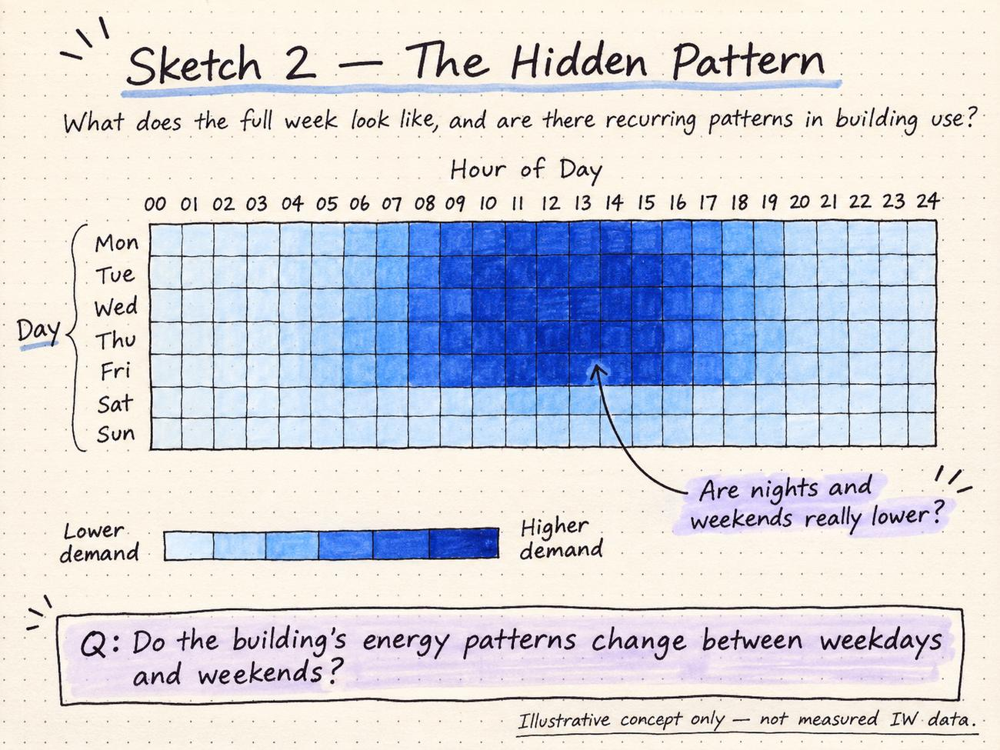
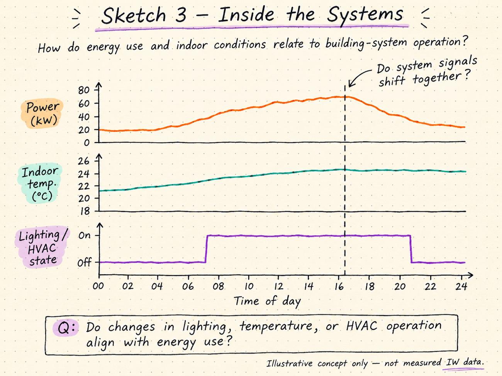
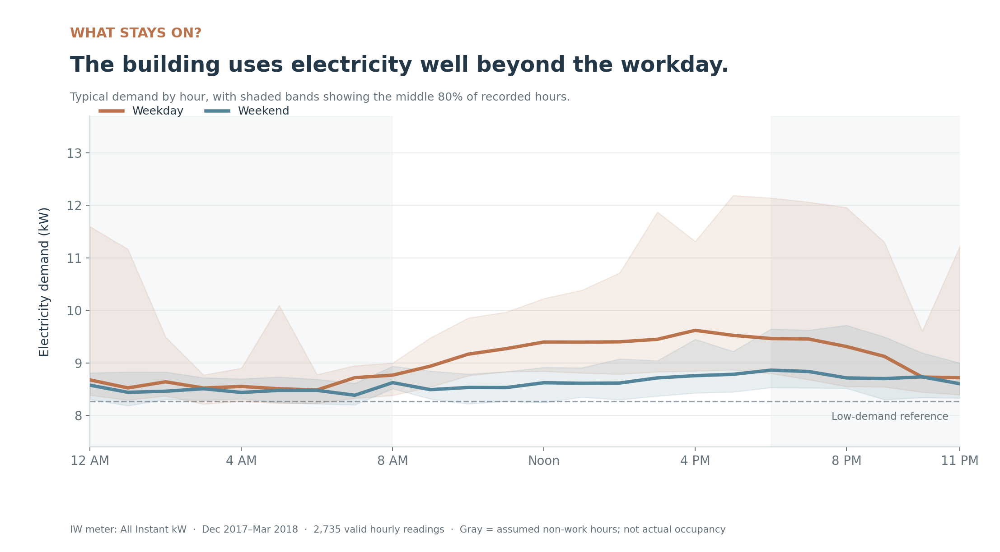
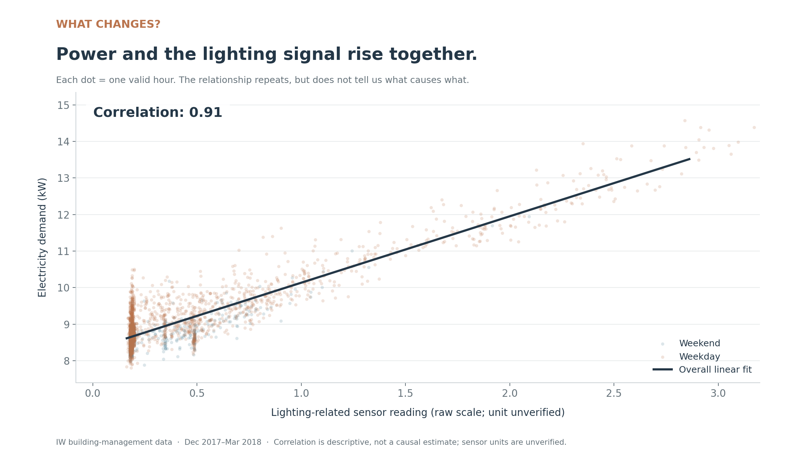
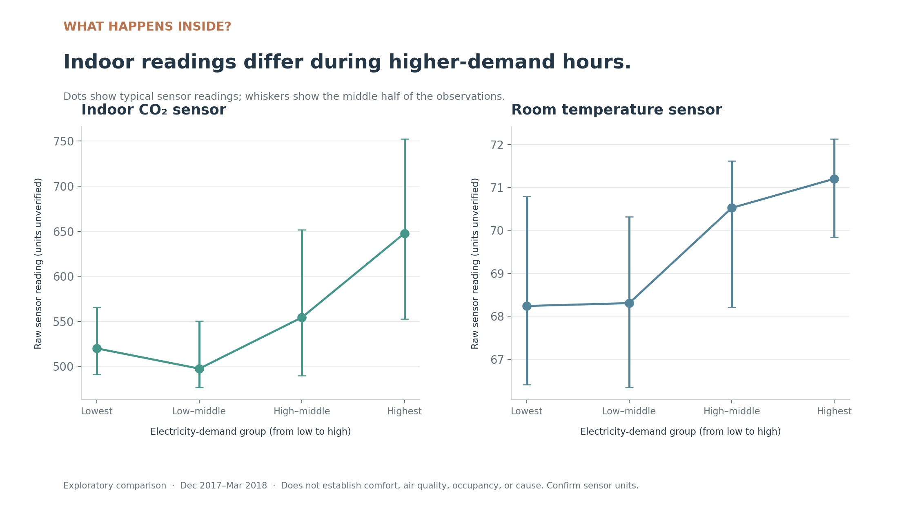

| [Home Page](https://marxcel2412.github.io/yash_tellingstories_portfolio/) | [Data Viz Examples](dataviz-examples) | [Viz Gov Debt](visualizing-government-debt) | [Critique By Design](critique-by-design) | [Final Project I](final-project-part-one) | [Final Project II](final-project-part-two) | [Final Project III](final-project-part-three) |

# The Two Lives of an Intelligent Building

**Final Project — Part I | Telling Stories with Data**

*What stays on, what changes, and what does it mean for a building to be “smart”?*

> **This is an investigation, not a verdict.** The charts use real measurements from Carnegie Mellon University's Intelligent Workplace (IW). They show patterns worth exploring, but they do not prove that electricity is wasted or that any particular building system is responsible.

## Outline

### The idea, in plain English

Imagine a building filled with sensors and systems designed to respond to what happens inside. You might expect its electricity use to rise when activity increases and fall when things become quiet. At CMU's **Robert L. Preger Intelligent Workplace**, we have an unusual opportunity to test that assumption: historical records show the building's electrical demand and readings from several building systems, hour by hour.

The early results suggest **two overlapping stories**. One is fairly steady: even during the quietest recorded periods, the building continues using a considerable amount of electricity. The other changes: electricity use rises and falls alongside a lighting-related sensor signal. I want to understand both, without assuming that the steady demand is unnecessary or that lighting explains all the variation. I also want to ask what was happening inside the building at those times.

The project will use **actual measured data** to move from a simple observation (“the building keeps using power”) to a more interesting question (“what changes, what stays steady, and what can the indoor readings tell us?”). As a research workplace, the IW may have after-hours needs that a conventional office does not. The aim is to make building operation understandable to people who have never studied building engineering.

### Three questions that drive the story

1. **What stays on?** How much electricity does the building use during its lower-demand hours?
2. **What changes?** Do power and other building-system readings rise and fall together?
3. **What happens inside?** What do indoor sensor readings look like when power use is lower or higher?

**Audience:** Anyone curious about buildings and sustainability, especially students, designers, and building operators. No engineering background should be necessary.

**Main message to test:** A smart building is more than a low electricity bill. To understand its performance, we need to look at **when it uses energy, which signals change with it, and what is happening inside**.

### Proposed story: five short chapters

| Chapter | What the reader discovers | Main visual |
|:--|:--|:--|
| **1. The promise** | Meet the Intelligent Workplace, a research building with many monitored systems. What would we expect a responsive building to do? | Photograph and simple building-systems illustration |
| **2. The building that stays awake** | Electrical demand continues during quieter hours. How steady is that demand? | Daily electricity profile with the spread of readings |
| **3. The building that responds** | Some readings change markedly. Power and a lighting-related signal move together, but the relationship needs explanation. | Power-versus-lighting scatterplot |
| **4. What happens inside?** | Indoor CO₂ and room-temperature sensor readings differ across power-demand levels. Are those relationships meaningful? | Two easy-to-read indoor-condition comparisons |
| **5. What have we really learned?** | Separate what the measurements show from what requires information about occupancy, meter coverage and system controls. | Evidence summary and an invitation to ask better operational questions |

The story moves through **expectation → surprise → investigation → interpretation**. The ending will follow the evidence, rather than assume the building is good or bad.

## Initial sketches: where this started

These three hand-drawn-style **AI-assisted concept sketches** were created before the expanded analysis. They show the intended storytelling sequence, **not actual IW measurements**. I have kept them here so readers can see how the project developed.

### Sketch 1 — The daily rhythm

*An opening chart to ask what happens to electricity demand after a typical workday ends.*

### Sketch 2 — The hidden pattern

*An hourly color grid to reveal recurring activity patterns and days that look different. In the measured version, individual calendar dates replace the seven illustrative weekday rows.*

### Sketch 3 — Inside the systems

*A way to compare several building readings on the same timeline, without assuming that one causes another.*

**How the plan changed:** My classroom discussion did not generate extensive actionable feedback, so I used preliminary data analysis to sharpen the central question. Rather than make “after hours” the whole project, I am treating it as the opening chapter of a broader story about **steady demand, changing activity, and indoor conditions**.

## The first findings: real data, real questions

The charts below use recorded measurements from **December 2017 through March 2018**. These are working analyses, not final conclusions.

### Finding 1 — What stays on?

*Figure 1. A typical day of electricity demand. The lines show the median for each hour; lighter bands show the middle 80% of measured values. Gray areas indicate hours outside the **assumed** 8 AM–6 PM workday.*

Even in its quieter hours, the monitored power demand remains substantial. Across the four months, the **5th percentile** of measured hourly demand was about **8.27 kW**, compared with approximately **11.26 kW at the 95th percentile**. In everyday terms, electricity demand changes, but the low-use level is still sizable.

**What this does not tell us:** Whether the remaining electricity is essential, avoidable, or associated with a particular piece of equipment. We do not yet have verified occupancy or a complete list of what the meter supplies.

### Finding 2 — What changes alongside demand?

*Figure 2. Each dot is one valid hour. The two readings tend to rise together across weekdays and weekends.*

The relationship between the **lighting-related signal** and electrical demand is strong in these records (a correlation of approximately **0.91**). More simply: **hours with a higher lighting-related reading also tend to be hours with higher electrical demand**. The pattern appears in each of the four months.

That makes the lighting signal a useful clue, **not an answer**. The sensor's precise units and what it measures have not been confirmed. We cannot conclude that lighting alone explains the change, or that the correlation shows cause and effect.

### Finding 3 — What happens inside the building?

*Figure 3. Recorded indoor CO₂ and room-temperature values compared across four groups of electricity demand. Dots show typical values and whiskers show the middle half of the observations.*

The room-temperature and CO₂ readings are **not identical** across low- and high-demand hours. This opens up a more human question: *What is happening inside the building when its systems are more active?*

At this stage, these are **raw sensor readings**. Before drawing conclusions about comfort or air quality, I need to confirm their units, sensor locations and whether people were actually present. Higher CO₂ can be consistent with human activity, but it is not a verified occupant count.

### A reality check — Did the pattern change with the seasons?

*Figure 4. Monthly median demand and its 10th–90th percentile range. This is a winter-to-early-spring check, **not a full seasonal analysis**.*

| Month | Typical hourly demand |
|:--|--:|
| December 2017 | 8.80 kW |
| January 2018 | 8.69 kW |
| February 2018 | 8.85 kW |
| March 2018 | 8.80 kW |

The typical demand did not change dramatically across these months, even though higher-demand hours varied. **That is an observation, not evidence that outdoor conditions have no effect.** We would need weather information and a wider seasonal range to test that properly.

### What the first analysis suggests

We can say that the building has **an enduring level of electrical demand** and **activity-related changes worth investigating**. We cannot yet say whether its controls are performing well, how much electricity is necessary after hours, or what the energy–comfort trade-off might be. Those are the important next questions.

## The data: where it comes from, what I used, and what I checked

### Source and permission

My source is a collection of historical **building-management-system reports from CMU's Intelligent Workplace**, which I have permission to use for this class project. The reports include measurements of electrical demand, a lighting-related signal, CO₂, humidity and room temperature, along with many other building controls. I have selected a small set of relevant, nonpersonal readings rather than publish the full archive, which also contains named comfort-response fields.

### Public data for reproduction

**[Download the cleaned hourly dataset: December 2017–March 2018](data/IW_hourly_Dec2017_Mar2018.csv)**

[View the data on GitHub](https://github.com/marxcel2412/yash_tellingstories_portfolio/blob/main/data/IW_hourly_Dec2017_Mar2018.csv)

The file contains **2,904 hourly time slots**, including **2,735 usable hours** after quality checks. It retains flagged records so that another analyst can see what was excluded rather than silently deleting inconvenient data.

For comparison with the first project draft, I also retained the [January–February 2018 dataset](data/IW_public_hourly_Jan_Feb_2018.csv).

| Source field | What it means in this study | Important caution |
|:--|:--|:--|
| `All Instant kW` | Total reported electrical-demand reading (kW) | Meter boundary and connected equipment need confirmation |
| `All_Lighting_Cons` | Lighting-related signal | Physical unit and sensor meaning need confirmation |
| `IW.1.RCO2` | Indoor CO₂ sensor reading in one monitored zone | Cannot independently establish occupancy or air quality |
| `IW.1.RMT` | Room-temperature sensor reading in one monitored zone | Unit is not yet confirmed; cannot independently establish comfort |
| `IW.1.RHM` | Humidity-related sensor reading in the same zone | Needs sensor-unit verification |

### How I cleaned the records

The original exports are **five-minute measurements**. I grouped them into hourly averages to make the patterns easier to compare. Before doing so, I checked the dates inside each report: some filenames refer to the export month rather than the month measured.

I flagged **seven dates** with almost completely unchanged electrical readings: December 9, 2017; January 22, 2018; February 12, 18, 26 and 28; and March 27, 2018. These may be reporting problems, so their 168 hours are not used in the first charts. The missing 2 AM hour on **March 11, 2018** corresponds to the daylight-saving time transition and is marked separately, not mistaken for a full-day meter fault.

These quality checks leave **2,735 valid hours** for the first four-month analysis. The dataset includes a `Power_QA_Flag` column documenting this choice. An hour with no reading is never silently treated as zero demand.

### What the available archive can—and cannot—tell us about seasons

I checked the original ZIP's report headers rather than infer date coverage from filenames. The available exports cover **selected Decembers, Januaries, Februaries, Marches and Aprils between 2013 and 2020**. No summer reports were supplied, and the April 2018 export is incomplete in the truncated ZIP. The four consecutive verified months used here are **December 2017–March 2018**.

That is enough for a first look at **winter into early spring**, but **not enough to claim what happens across all four seasons**. A genuine summer comparison will require additional records. I will therefore keep seasonality as a question, not a claimed finding.

## Method and medium

I plan to build the final piece as a **guided interactive story**, not a dashboard of unrelated charts. **Tableau** will let readers explore the evidence through simple chart interactions; **Shorthand** will provide the chapter-by-chapter narrative, explanations and transitions. GitHub Pages will document the proposal, source data, sketches, revisions and final link.

Because the intended reader is not necessarily an engineer, I will explain every graph with one plain-language question and takeaway. Technical details—sensor names, cleaning rules and limitations—will remain available below each section for readers who want to look deeper.

### Next checks before drawing conclusions

1. **Confirm what the power meter and lighting-related signal measure.** Their names alone are not adequate sensor documentation.
2. **Confirm indoor sensor units and zones.** Until then, the indoor comparison describes readings, not comfort or health.
3. **Add building-operation and occupancy context if available.** This is needed before judging whether steady demand is necessary or avoidable.
4. **Check other periods and weather data.** The supplied archive does not contain summer measurements, so a four-season story is not yet possible.
5. **Test the story with actual readers.** Future classroom interviews should focus on the measured findings, the terminology and whether the narrative makes sense without engineering knowledge.

## References

- Carnegie Mellon University, [Center for Building Performance and Diagnostics and the Intelligent Workplace](https://www.cmu.edu/architecture/research/centers-labs/cbpd/index.html). Building and research context.
- **Primary data:** Historical Intelligent Workplace building-management-system exports, December 2017–March 2018, shared with permission for the course. A cleaned, selected dataset is linked above.
- Scott Berinato, *Good Charts*. Audience, narrative structure and chart selection.
- Course assignment: *Telling Stories with Data*, Final Project Part I instructions and rubric.

## AI acknowledgements

I used **ChatGPT (OpenAI)** to brainstorm and structure the proposed narrative, generate exploratory sketches (which are explicitly illustrative), help recover and interpret the source CSV reports, flag data-quality concerns, calculate preliminary comparisons, create draft charts, prepare an hourly analysis dataset, and assist with the Markdown/GitHub portfolio page. The choice of IW as the case study and permission to use the underlying data are my own. Preliminary findings and proposed explanations remain subject to verification.

For this revision, ChatGPT also helped review the wider archive, compare power and lighting-related readings, examine indoor sensor data, develop four evidence-based figures, and revise the story for a nontechnical audience. The source limitations, QA exclusions and preliminary nature of the findings are documented above.

---

[← Back to portfolio home](https://marxcel2412.github.io/yash_tellingstories_portfolio/)
