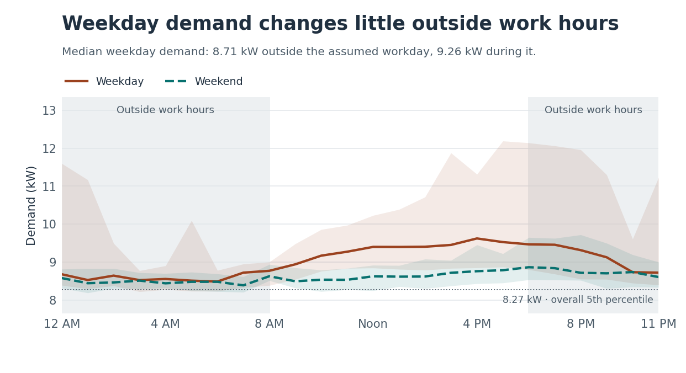
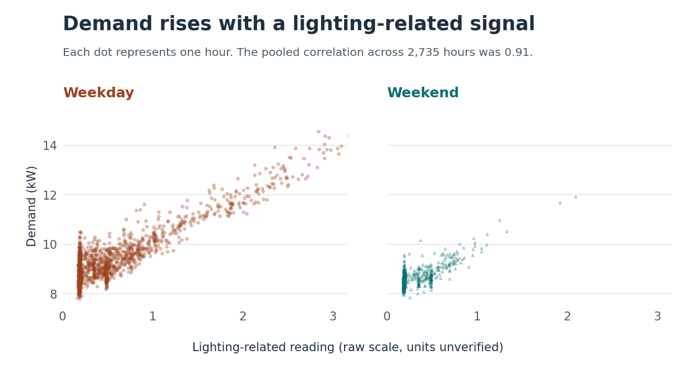
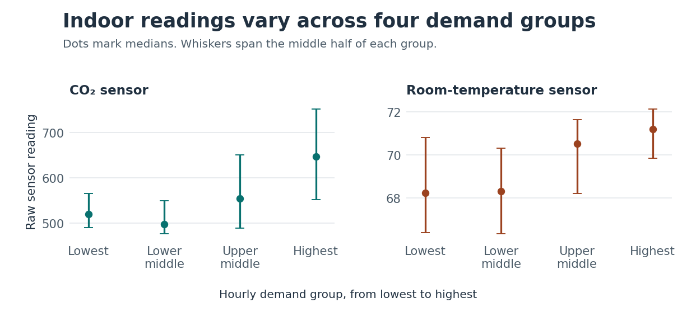
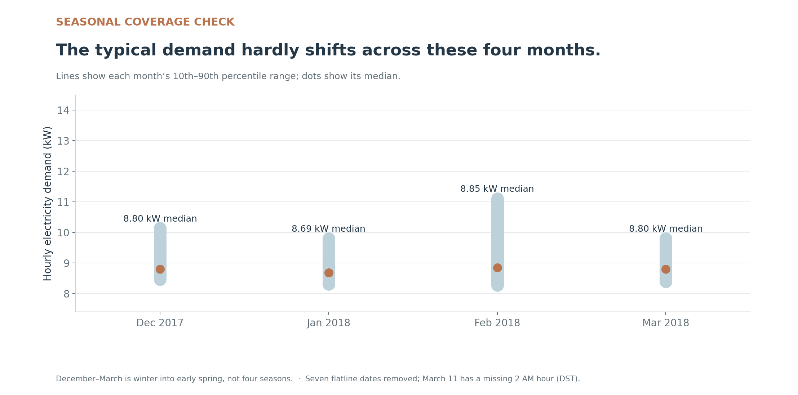
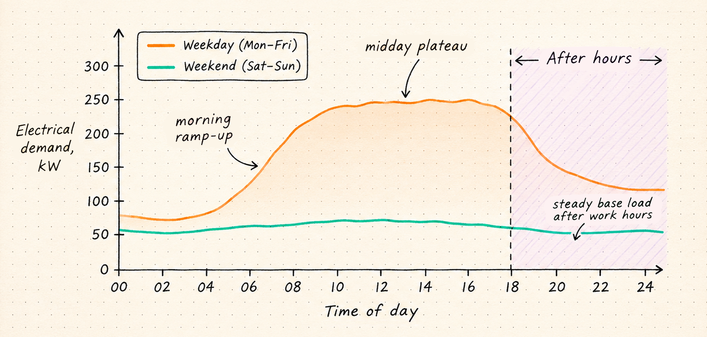
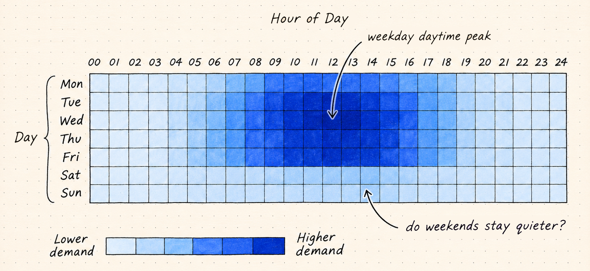
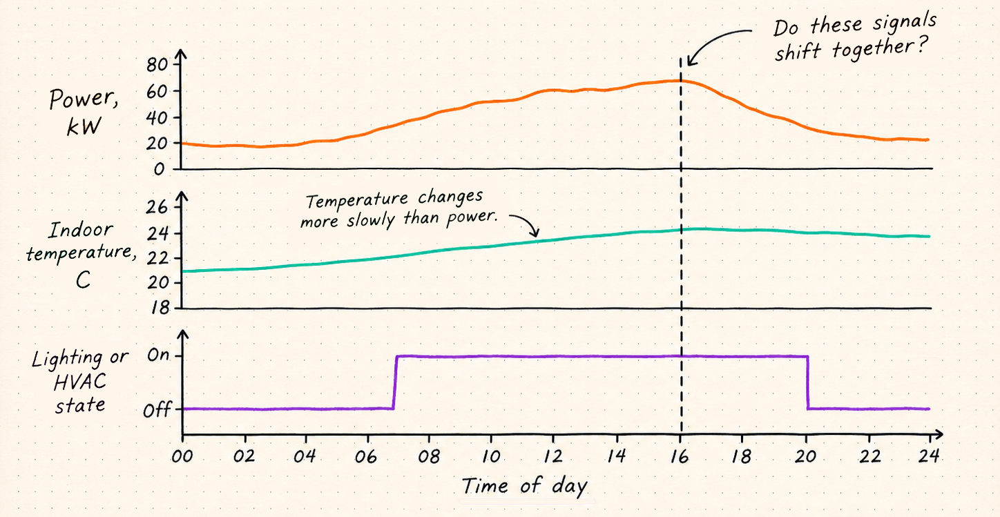

| [Home Page](https://marxcel2412.github.io/yash_tellingstories_portfolio/) | [Data Viz Examples](dataviz-examples) | [Viz Gov Debt](visualizing-government-debt) | [Critique By Design](critique-by-design) | [Final Project I](final-project-part-one) | [Final Project II](final-project-part-two) | [Final Project III](final-project-part-three) |

# The Two Lives of an Intelligent Building

*How much does electricity demand drop outside a typical workday?*

At Carnegie Mellon’s **Robert L. Preger Intelligent Workplace**, a rooftop research workplace above Margaret Morrison Carnegie Hall, the meter recorded a median weekday demand of **8.71 kW outside the assumed workday** and **9.26 kW during it**. The outside-hours median was about **94%** of the work-hours median. What keeps demand so steady, and what changes when it rises? [See the Intelligent Workplace photograph by Karl Backus on CMU’s website](https://www.architecture.cmu.edu/cbpd).

*Figure 1. Hour-by-hour profiles from December 2017 through March 2018. Lines show medians and colored bands span the 10th to 90th percentiles for each hour. Gray marks hours outside the assumed weekday schedule. The dotted 8.27 kW line is the 5th percentile across all valid hours.*

I use **8 a.m. to 6 p.m. on weekdays** as a comparison window. Actual occupancy and the equipment served by the meter are unverified, so the amount of needed or avoidable demand remains open.

## Outline

**Audience.** I’m writing for CMU students who are curious about how campus buildings work. The data and methods are available for readers who want to investigate further.

| Chapter | What the reader discovers | Main visual |
|:--|:--|:--|
| **1. A workplace on the roof** | The Intelligent Workplace is both a research lab and a place people work. | Building photograph |
| **2. How much demand remains?** | Typical weekday demand changes little outside the assumed workday. | Daily demand profile |
| **3. What rises with demand?** | Power and a lighting-related reading move together across the four months. | Weekday and weekend scatterplots |
| **4. What happens indoors?** | Indoor sensor readings vary across demand levels. | Two compact sensor comparisons |
| **5. What would explain the pattern?** | Meter coverage, occupancy, and control schedules would help explain what stays on and why. | Evidence summary |

## The first findings: real data, real questions

### A lighting-related reading rises with demand

*Figure 2. Each dot represents one valid hour. Both panels use the same scales.*

The pooled correlation was **0.91** and ranged from **0.90 to 0.94** across the four months. The signal’s definition and units are unverified. If lighting is included in the metered total, part of the relationship may reflect one component moving with the total. Confirming which loads the meter covers would help interpret the pattern.

### Indoor readings across demand levels

*Figure 3. Hours are divided into four roughly equal groups by electricity demand.*

Median room-temperature readings rose across the groups. Median CO₂ dipped in the second group and then rose in the third and fourth. The middle ranges overlap. Interpreting these patterns in terms of comfort, air quality, or occupancy would require verified units, sensor locations, and occupancy records.

### Did typical demand change from December to March?

*Figure 4. Dots show monthly medians and bars span the 10th to 90th percentiles.*

Monthly medians were close, ranging from **8.69 to 8.85 kW**. February had the widest middle-80% range. A seasonal comparison would require measurements from other times of year and weather records.

## Initial sketches: where this started

I made these hand-drawn sketches and used AI to clean them up. The classroom discussion brought out how difficult it was to explain the building systems to people outside my field. I used that as a cue to open with a comparison anyone can read before introducing individual sensors.

### Sketch 1: The daily rhythm

*Figure 5. Illustrative concept with placeholder values. I initially sketched a steep daytime rise. The measured profile showed a much smaller shift, which became the opening finding.*

### Sketch 2: The hidden pattern

*Figure 6. A concept for spotting recurring patterns by hour. I prioritized the measured daily profile for the opening because it makes the work-hours comparison easier to read. A calendar-date heatmap could help investigate unusual days later.*

### Sketch 3: Inside the systems

*Figure 7. Illustrative concept with placeholder values. For this draft, I used a scatterplot to compare paired demand and lighting-related readings and grouped hours to compare the indoor readings.*

## Where does the data come from?

### Source and permission

I used historical building-management-system reports from CMU’s Intelligent Workplace with permission for this class project. The public files contain selected nonpersonal measurements of electrical demand, a lighting-related signal, CO₂, humidity, and room temperature.

### Public data for reproduction

**[Download the cleaned hourly dataset (December 2017–March 2018)](data/IW_hourly_Dec2017_Mar2018.csv)**

[View the data on GitHub](https://github.com/marxcel2412/yash_tellingstories_portfolio/blob/main/data/IW_hourly_Dec2017_Mar2018.csv)

For comparison with the first project draft, I also retained the [January–February 2018 dataset](data/IW_public_hourly_Jan_Feb_2018.csv).

### How I prepared the hourly data

I grouped the original **five-minute measurements** into hourly averages. The export contains **2,904 hourly slots**. I used the **2,735 hours** marked `pass` in `Power_QA_Flag`. The file retains **168 hours** flagged as suspect because the electrical readings were nearly flat across seven dates. It also retains one missing slot, at 2 a.m. on March 11, 2018, during the daylight-saving transition. The missing value is blank.

Work hours are weekdays from 8 a.m. up to 6 p.m. in the report timestamps. I calculated the two opening medians across individual weekday hours inside and outside that window. The hourly lines in Figure 1 group readings by clock hour and weekday or weekend.

## Method and medium

I plan to use **Shorthand** for the guided story and **Tableau** to let readers explore the measured patterns. This GitHub Pages portfolio documents the proposal, sketches, evidence, and revisions. My next checks are to confirm what the electricity meter serves, identify the lighting-related and indoor sensor fields, and look for occupancy and control schedules.

## References

- Carnegie Mellon University, [Center for Building Performance and Diagnostics](https://www.architecture.cmu.edu/cbpd). Building context and photograph by Karl Backus.
- **Primary data.** Historical Intelligent Workplace building-management-system exports, December 2017 through March 2018, shared with permission for the course. The cleaned subset is linked above.
- Scott Berinato, *Good Charts*. Audience, narrative structure, and chart selection.
- Course assignment, *Telling Stories with Data*, Final Project Part I instructions and rubric.

## AI acknowledgements

I used **ChatGPT (OpenAI)** to brainstorm and structure the narrative, polish my exploratory sketches, help recover and interpret the source CSV reports, prepare the hourly analysis dataset and figures, check the headline statistics, and revise the GitHub page. I selected the Intelligent Workplace as the case study and obtained permission to use its data.

---

[← Back to portfolio home](https://marxcel2412.github.io/yash_tellingstories_portfolio/)
