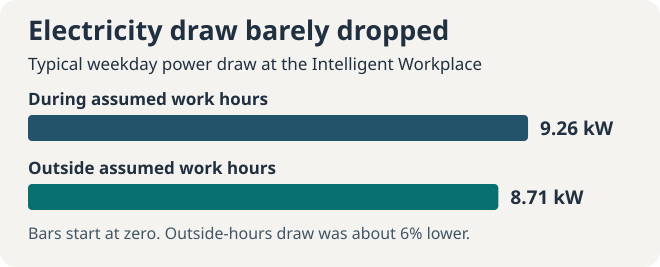
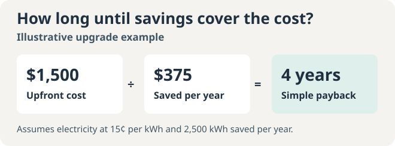

| [Portfolio home](https://marxcel2412.github.io/yash_tellingstories_portfolio/) | [Final Project I](final-project-part-one) | [Final Project II](final-project-part-two) | [Final Project III](final-project-part-three) |

# The Two Lives of an Intelligent Building

*Final Project II · Storyboard, draft charts, and user research*

[Read the draft story](#storyboard-and-draft-story) · [See what the readers said](#interview-findings) · [Read the interview protocol](#user-research-protocol)

## Storyboard and draft story

### Start with an electricity bill

Imagine a space heater rated at **1,000 watts**. Run it at full power for one hour and it uses **one kilowatt-hour (kWh)** of electricity. At an example price of **15¢ per kWh**, that hour costs **15¢** in electricity. Keep the heater running for ten hours and that becomes **$1.50**. A kilowatt measures how fast something draws electricity. A kilowatt-hour measures how much it uses over time.

An **energy-efficient building** uses less energy to do the same job, like keeping a room comfortable or giving people enough light to work. For example, a timer can switch off lights in a room nobody is using. Across a building, some equipment may still need to run after the workday. The question is which equipment needs to stay on, and for how long.

### What happened at CMU after work hours?

I looked at the **Intelligent Workplace**, a research lab and workspace above Margaret Morrison Carnegie Hall. I expected a big drop in electricity use after a typical workday, much like turning off the lights when leaving a room. [See CMU’s photograph of the Intelligent Workplace, credited to Karl Backus](https://www.architecture.cmu.edu/cbpd).

*Original sketch from Part I. It shows my expectation with placeholder values.*

*Measured at the Intelligent Workplace from December 2017 through March 2018. “Typical” is the median of the hourly readings in each group. I used 8 a.m. to 6 p.m. as a weekday schedule for comparison. The meter records leave actual occupancy unknown.*

Outside that schedule, the meter showed only about **6% less** power draw. Using the heater as a yardstick, **8.71 kW is roughly the draw of nine of those heaters running at once**. That gives a sense of scale for the meter reading. Which equipment actually drew the power is an open question.

### What would saving electricity be worth?

At the same example rate of **15¢ per kWh**, one hour at **8.71 kW** would come to about **$1.31** in electricity charges. One hour at **9.26 kW** would come to about **$1.39**. Those are illustrations for one hour at each power level. CMU’s actual rate and billing terms are unknown here.

**How long would an upgrade take to pay for itself?** Imagine a **$1,500** controls upgrade that actually reduced power draw by **1 kW for 10 hours a day on 250 days a year**. Here’s how the example works out at 15¢ per kWh.

*Illustrative example. 1 kW × 10 hours × 250 days = 2,500 kWh saved per year. At 15¢ per kWh, that is $375 per year. $1,500 ÷ $375 = four years. This simple calculation uses electricity savings alone.*

To estimate **real payback at the Intelligent Workplace**, I would need the installed cost, CMU’s electricity rate and billing terms, and a before-and-after comparison that shows how much electricity the change saved under comparable conditions. The current meter readings show a pattern across hours. They give me a place to investigate potential savings.

### What would you ask campus facilities?

Think of a campus building you use. If its meter barely dropped after work hours, **what would you ask before spending money to change it?** My first question would be: *Which equipment is on the meter, and which of it needs to run outside work hours?* The answer would help decide where to measure next and whether there is a practical change worth pricing.

### Storyboard and supporting charts

The [original hourly profile](assets/iw-demand-profile.png) shows how weekday and weekend readings change through the day. The [lighting comparison](assets/iw-demand-lighting.png), [indoor readings](assets/iw-indoor-readings.png), and [monthly comparison](assets/IW_deep_04_winter_spring.png) provide technical context. The lighting-related reading’s units and the equipment served by the meter still need verification.

## Interview findings

I spoke with **three classmates** about the earlier Part II explanation. The group found it very hard to follow. They wanted a comparison with something familiar and more explanatory, less technical charts. The discussion also identified the need to explain efficient buildings up front, use dollars because readers recognize what they pay more readily than kWh, and show how an upgrade might pay for itself. These are paraphrased group notes. Individual responses and verbatim quotes weren’t recorded in the notes available for this write-up.

A separate reviewer familiar with the Intelligent Workplace identified the sketch-to-meter reveal as the strongest moment and suggested moving the indoor charts out of the main story. That gave me a sequence to keep while simplifying the explanation around it.

| What readers raised | Change in this Part II draft |
|---|---|
| The basic topic and chart terminology were hard to follow. | I start with a heater and an electricity bill, then explain energy efficiency through a familiar example. |
| They wanted something familiar to compare with the workplace. | I use a 1,000-watt heater as a yardstick and put two directly labeled bars after the original sketch. |
| Dollars made more sense than kWh alone. | I show one hour at each typical power level using the same example price. |
| They wanted to know what systems cost and how quickly they could save money. | I show a worked payback example and list the records I’d need to estimate actual IW payback. |

## User research protocol

The first round tested whether classmates could follow the story. For a follow-up, I would show this revision to CMU students who use campus buildings and have little or no building-systems training. I would recruit three readers who have not worked on the project, give each 10–15 minutes, and take anonymous notes. I would pause before revealing the closing question.

I would start with: “I’m testing the story. Read at your own pace and tell me what makes sense or where you get stuck. Are you comfortable with me taking anonymous notes?”

1. **After the heater example:** What would happen to the electricity charge if you ran the same heater for twice as long?
2. **After the two bars:** What did the meter show after work hours? What does the chart tell you about who was in the building?
3. **After the payback example:** What does four years mean here? What would you need before using that figure for the Intelligent Workplace?
4. **Before the closing question:** What would you ask campus facilities or measure next?

## Design changes to test for Part III

I want to see whether readers can explain the difference between power draw and an electricity charge, describe the small difference across the two time windows, and identify the payback example as hypothetical. If they still struggle to follow the cost example, I’ll try a single step-by-step graphic. If I can obtain the installed costs, billing terms, and a comparable energy baseline, I can test whether a real payback estimate is possible.

## Sources and AI acknowledgment

- Historical Intelligent Workplace building-management-system exports, December 2017 through March 2018. [Cleaned hourly data](data/IW_hourly_Dec2017_Mar2018.csv) · [Preparation and quality checks](final-project-part-one#how-i-prepared-the-hourly-data).
- Carnegie Mellon University, [Center for Building Performance and Diagnostics](https://www.architecture.cmu.edu/cbpd). Building context and linked photograph.

I chose the case study, obtained permission to use the data, developed the original sketches, and spoke with classmates. I used ChatGPT to help process the hourly data, draft figures, and revise the story and protocol from my interview notes.

[Back to the portfolio](https://marxcel2412.github.io/yash_tellingstories_portfolio/)
