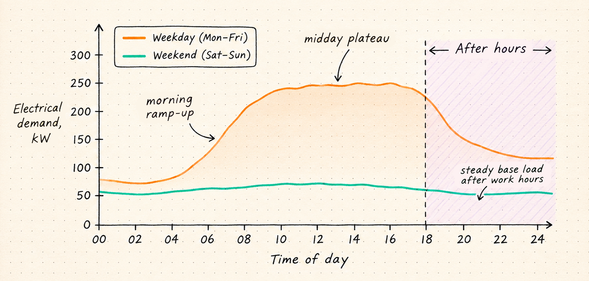
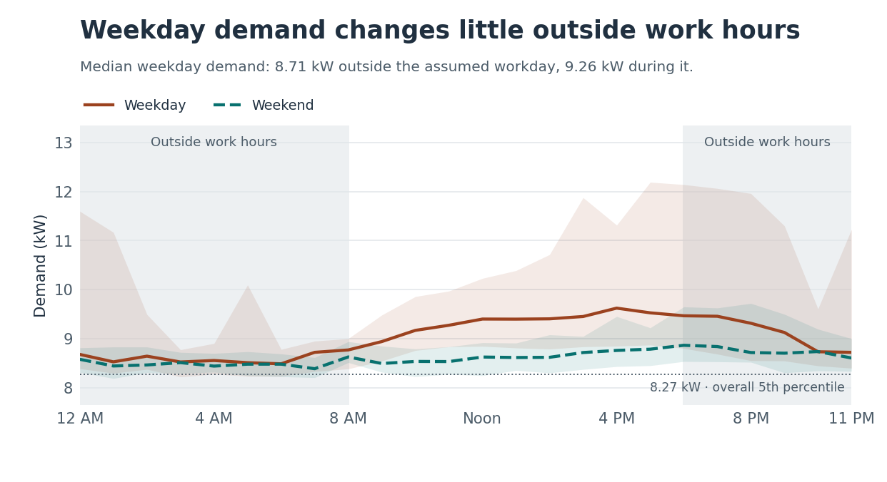

| [Portfolio home](https://marxcel2412.github.io/yash_tellingstories_portfolio/) | [Final Project I](final-project-part-one) | [Final Project II](final-project-part-two) | [Final Project III](final-project-part-three) |

# The Two Lives of an Intelligent Building

*Final Project II · Storyboard, draft charts, and user research*

[Start the draft story](#storyboard-and-draft-story) · [Read the interview protocol](#user-research-protocol) · [Interview findings and Part III](#interview-findings)

## Storyboard and draft story

This page is the working storyboard for a scroll-based story about CMU’s Intelligent Workplace. The panels show how the reader moves from the opening question through the measured comparisons to a closing reader task. The charts below use measured data from December 2017 through March 2018.

### How much does demand drop outside a typical workday?

Think about a campus building you use for class, study, or work. How much electricity would you expect it to draw after a typical workday? I asked that question about CMU’s Intelligent Workplace, a research lab and workspace above Margaret Morrison Carnegie Hall.

The comparison uses **8 a.m. to 6 p.m. on weekdays** as a schedule. The records do not include verified occupancy. [See CMU’s photograph of the Intelligent Workplace, credited to Karl Backus](https://www.architecture.cmu.edu/cbpd).

### 1. Follow the meter through a day

**What I expected.** I sketched a large rise during the day and a sharp drop afterward.

*Illustrative sketch from Part I. The values are placeholders.*

**What the meter recorded.** Median weekday demand was **8.71 kW outside the assumed workday** and **9.26 kW during it**, a difference of **0.55 kW**.

*Figure 1. Lines show the median demand at each hour. Bands show the middle 80% of readings. Gray marks the hours outside the assumed weekday schedule. The dotted line is the 5th percentile across all valid hours.*

Follow the solid weekday line from late afternoon into the evening. Demand tapers, then settles near its overnight level. The dashed weekend line is flatter. The meter shows a persistent demand, and identifying the equipment behind it requires a list of the loads connected to the meter.

### 2. Compare demand with a lighting-related reading

*Figure 2. Each dot is one valid hour. The two panels use the same axes so the weekday and weekend patterns can be compared.*

Higher lighting-related readings generally occur alongside higher demand. The overall correlation is **0.91**. The signal’s definition, its units, and the loads included in the power meter still need verification before I can explain the relationship.

### 3. Look inside the workplace

*Figure 3. Recorded hours are divided into four roughly equal groups by demand. The dots are medians and the whiskers span the middle half of each group.*

Median room-temperature readings rise across the demand groups. Median CO₂ readings dip in the second group before rising in the third and fourth. The ranges overlap. To relate either pattern to people’s experience, I need the sensor locations and units, along with occupancy records.

### 4. See how much the four months differ

*Figure 4. Dots show monthly median demand. Bars show the middle 80% of each month’s readings.*

Monthly medians stay close, from **8.69 to 8.85 kW**, while February has a wider spread. The four months give an early check on the pattern. Comparing seasons would require records from the rest of the year and weather data.

### What would you ask campus facilities?

Go back to the [daily demand profile](#1-follow-the-meter-through-a-day). Pick one evening hour and one hour during the workday. Compare the two points on the solid weekday line. **If you could ask campus facilities one question about what was still running, what would it be?**

For example: “Which equipment does this meter cover, and what needs to run in the evening?” The chart gives you a time and a measured pattern to ask about.

### From Part I sketches to this draft

Part I instructor feedback highlighted the campus setting and the difference between the first sketch and the measured profile. The feedback also asked me to define my reader more clearly and give them a next step. In this draft, I address students who use campus buildings, put the sketch immediately before the measured profile, and close with a question readers can take to campus facilities.

| Part I concept | Part II decision |
|---|---|
| [Daily rhythm sketch](assets/iw-sketch-01-daily-rhythm.png) | The sketch and the measured profile now appear together. The contrast between the expected drop and the measured 0.55 kW difference drives the story. |
| [Hourly heatmap sketch](assets/iw-sketch-02-weekly-heatmap.png) | The weekday and weekend profile introduces the time pattern first. A calendar-date heatmap could help investigate unusual days later. |
| [Inside the systems sketch](assets/iw-sketch-03-systems.png) | The aligned timelines become a pair of scatterplots for the lighting-related reading and two compact comparisons for indoor readings. |

## User research protocol

**Goal.** Test whether a first-time reader can explain the demand comparison, distinguish the assumed schedule from observed occupancy, and use the chart to ask a specific question about building operation.

**Target audience and recruitment.** The story is for CMU students who use campus buildings for class, study, or work and have little or no building-systems training. Recruit at least three students who have not worked on the project. Aim for two without building-science training and one who has encountered building or sustainability data. Record broad descriptions such as “student, unfamiliar with building data.”

**Session.** Allow 10–15 minutes per person. Use the draft story above and show it in order. Ask for a think-aloud first, then use the follow-up questions. Pause before the closing prompt and ask the unaided question before revealing it. Take anonymous notes on what readers say and do. Ask permission before recording a quotation and omit identifying details from any notes posted here.

**Opening script.** “I’m testing how clearly this draft explains electricity demand at a campus workplace. Please read it at your own pace and tell me what you notice, what you expect next, or where you get stuck. You can skip any question. Is it okay if I take anonymous notes?”

| When | Question or task | What to note |
|---|---|---|
| After the opening | In your own words, what is this story about? What do you expect to see next? | First takeaway and expectations. |
| At the daily profile | Point to an hour outside the assumed workday. How does weekday demand there compare with the daytime? What do the lines and shaded areas mean to you? What can you tell about whether people were in the building? | Whether the reader can compare points and distinguish schedule shading from occupancy evidence. |
| At the scatterplots | What changes as you read from left to right? What, if anything, would you conclude about the lights? | Whether the reader sees an association or treats the chart as proof of a cause. |
| At the indoor charts | What do you notice about the lowest- and highest-demand groups? What would you need to know to interpret this as someone using the space? | Whether the reader notices the spread and asks about units, occupancy, or comfort. |
| Before showing the closing prompt | What would you tell a friend about the building? What, if anything, would you do or ask next? | The reader’s unaided takeaway and next step. |
| After showing the closing prompt | Pick an evening and a daytime point on the weekday line. What question would you ask campus facilities based on that comparison? | Whether the reader can use the prompt to form a specific question and what they needed help with. |

## Interview findings

Part II interview findings are pending. The storyboard above is the version prepared for testing.

## Design changes to test for Part III

These are candidate revisions to evaluate with readers during the interviews.

| What to listen for | Candidate revision |
|---|---|
| Readers treat the assumed schedule as proof of when the building is empty. | Put “schedule assumption” directly beside the shading and repeat the occupancy limitation at the opening. |
| Readers struggle to compare the 8.71 and 9.26 kW figures with the daily profile. | Add a short annotation pointing to the evening and overnight segment. |
| Readers take the scatterplots as evidence that the lights cause the change. | Add a plain-language annotation explaining the relationship and naming the missing meter information. |
| Readers lose the thread at the indoor or monthly comparison. | Move the less useful comparison into a short evidence note after the main story. |
| Readers still come away without a specific question for facilities. | Use a worked example tied to two labeled hours and test whether readers can then ask a question of their own. |

## Sources and AI acknowledgment

- Historical Intelligent Workplace building-management-system exports, December 2017 through March 2018. [Cleaned hourly data](data/IW_hourly_Dec2017_Mar2018.csv) · [Preparation and quality checks](final-project-part-one#how-i-prepared-the-hourly-data).
- Carnegie Mellon University, [Center for Building Performance and Diagnostics](https://www.architecture.cmu.edu/cbpd). Building context and linked photograph.

I chose the Intelligent Workplace as the case study, obtained permission to use the data, and developed the original concepts. I used ChatGPT to help process and check the hourly data, develop the draft figures, and draft this storyboard, page text, and interview protocol.

[Back to the portfolio](https://marxcel2412.github.io/yash_tellingstories_portfolio/)
