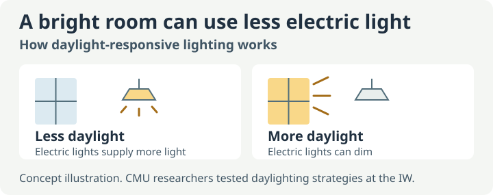
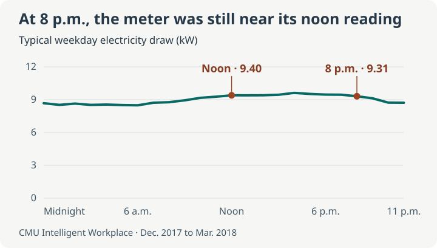
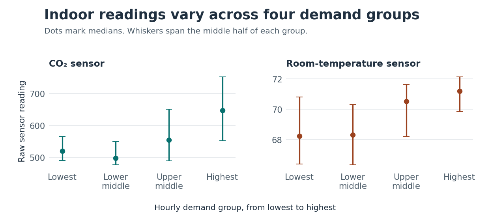
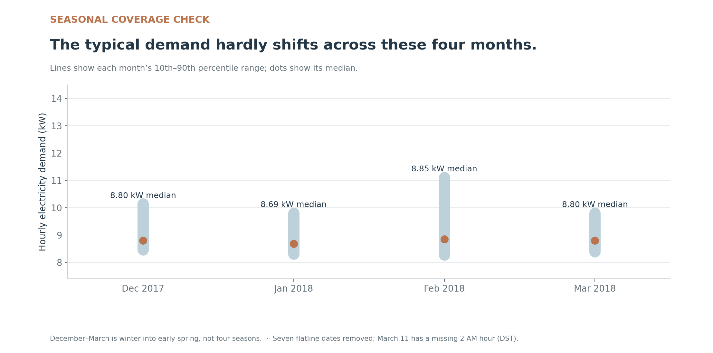
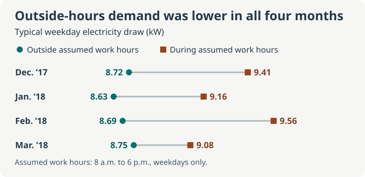
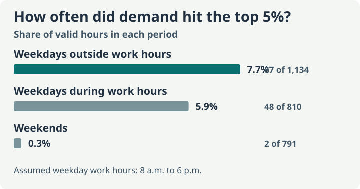
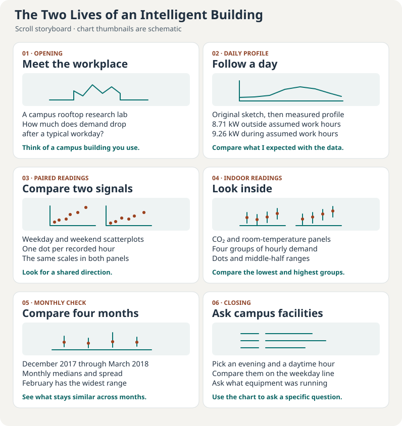

| [Portfolio home](https://marxcel2412.github.io/yash_tellingstories_portfolio/) | [Final Project I](final-project-part-one) | [Final Project II](final-project-part-two) | [Final Project III](final-project-part-three) |

# The Two Lives of an Intelligent Building

*A smart campus workplace by day. What does its electricity meter tell us after hours?*

*Final Project II · Storyboard, draft charts, and user research*

[Start the draft story](#storyboard-and-draft-story) · [Read the interview protocol](#user-research-protocol) · [Interview findings and Part III](#interview-findings)

## Storyboard and draft story

### What makes this workplace smart?

Imagine sitting in a classroom when the sun comes out. If daylight keeps the room bright, the electric lights can dim and the room can do the same job with less electricity. That is one way a smart building can adapt to changing conditions.

CMU’s **Intelligent Workplace**, a research lab and workspace above Margaret Morrison Carnegie Hall, was designed to test ideas like this. Its design brings together daylight, natural ventilation, and controls that let people adjust conditions where they work. CMU researchers later used the space to test how different skylights and shades manage daylight. [See the Intelligent Workplace](https://www.architecture.cmu.edu/cbpd) · [Read the original design study](https://doi.org/10.1016/S0926-5805(97)00019-8)

*This diagram illustrates the design idea behind daylight-responsive lighting.*

That made me curious about the end of the workday. **How much would the meter reading change from noon to 8 p.m.?** I sketched the drop I expected. Before you scroll, take a guess.

*My Part I sketch shows the pattern I expected. Its numbers are illustrative.*

[See what the meter recorded](#1-follow-the-meter-through-a-day)

### 1. Follow the meter through a day

**Panel 2 · The reveal.** The meter typically showed **9.40 kW at noon** and **9.31 kW at 8 p.m.** That is a small change for the steep drop I had imagined. Find the two labeled points on the line. A kilowatt, or kW, measures how fast something draws electricity.

Across all valid weekday readings, the median was **9.26 kW during** assumed work hours and **8.71 kW outside** them, about **6% lower**. I used **8 a.m. to 6 p.m. on weekdays** as a comparison window. The records leave actual occupancy unknown.

Smart controls can change how individual systems operate. The meter gives one reading for all the equipment it serves. The next chart offers one clue about what changes alongside the meter reading.

[Follow one clue](#2-compare-demand-with-a-lighting-related-reading)

### 2. Compare demand with a lighting-related reading

**Panel 3 · Look at the left edge of both charts.** Even near the lowest lighting-related readings, the meter often showed **around 8–9 kW**. Each dot is one recorded hour. Farther right means a higher reading on the recorded scale.

Daylight-responsive lighting is an example of what the IW was designed to explore. The chart uses a recorded lighting-related signal whose units and exact meaning still need verification. To explain the power draw visible at the left edge, I’d first find out which equipment this meter serves. [See the technical notes](#supporting-evidence).

[Use what you saw to frame a question](#what-would-you-ask-campus-facilities)

### What would you ask campus facilities?

**Panel 4 · Compare noon and 8 p.m.** Go back to the [weekday line](#1-follow-the-meter-through-a-day) and look at the two marked hours. Then ask:

> At CMU’s Intelligent Workplace, the meter was still near its noon reading at 8 p.m. **Which equipment does this meter serve, and which of it needs to run at 8 p.m.?**

That gives Facilities a specific time and a meter record to investigate. I’d ask them to check the equipment list and what was scheduled to run at 8 p.m. That would help explain how the IW’s smart systems operated alongside the other equipment served by the meter. [CMU Facilities Management Services](https://www.cmu.edu/fms/about/index.html)

## Supporting evidence

### How would I compare the IW with another campus workplace?

A fair energy-efficiency comparison would start with annual electricity, heating, and cooling for the IW itself, its floor area, and the same information for workplaces with a similar function and operating schedule. The four months here show when the meter recorded demand. An annual comparison per square foot would answer how the IW performs relative to those peers. [ENERGY STAR guide to energy use intensity](https://www.energystar.gov/buildings/benchmark/understand-metrics/what-eui)

### Full daily profile

Lines show the median demand at each hour. Bands show the middle 80% of readings. Gray marks the hours outside the assumed weekday schedule. The dotted line marks the 5th percentile across valid hours. In the lighting comparison above, the pooled correlation across valid hours was **0.91**. The signal definition, its units, and meter coverage still need verification.

### 3. Look inside the workplace

*Figure 3. Recorded hours are divided into four roughly equal groups by demand. The dots are medians and the whiskers span the middle half of each group.*

Median room-temperature readings rise across the demand groups. Median CO₂ readings dip in the second group before rising in the third and fourth. The ranges overlap. To relate either pattern to people’s experience, I need the sensor locations and units, along with occupancy records.

### 4. See how much the four months differ

*Figure 4. Dots show monthly median demand. Bars show the middle 80% of each month’s readings.*

Monthly medians stay close, from **8.69 to 8.85 kW**, while February has a wider spread. The four months give an early check on the pattern. Comparing seasons would require records from the rest of the year and weather data.

### Did the work-hours gap hold each month?

The gap held in each measured month, from **0.33 kW in March** to **0.88 kW in February**. The paired chart uses weekdays only and compares the two schedule windows within each month. Differences are calculated before rounding.

### When did the highest readings occur?

*The bars account for how many hours were recorded in each group. A high-demand reading occurred in 7.7% of hours outside assumed weekday work hours, compared with 5.9% during them and 0.3% on weekends.*

Of the **137 highest-demand hours** among the **2,735 valid hours**, **58** occurred on weekdays at 6 p.m. or later and **29** occurred on weekdays before 8 a.m. Together, those two groups accounted for about **64% of the highest readings** and **41% of all valid hours**. The other highest readings occurred during assumed weekday work hours (48) or on weekends (2). These are hours in the recorded period.

Earlier storyboard overview

### From Part I sketches to this draft

Part I instructor feedback highlighted the campus setting and the difference between the first sketch and the measured profile. The feedback also asked me to define my reader more clearly and give them a next step. In this draft, I address students who use campus buildings, let readers make a prediction from the sketch before revealing the measured profile, and close with a question readers can take to campus facilities.

| Part I concept | Part II decision |
|---|---|
| [Daily rhythm sketch](assets/iw-sketch-01-daily-rhythm.png) | The sketch and the measured profile now appear together. The contrast between the expected drop and the measured 0.55 kW difference drives the story. |
| [Hourly heatmap sketch](assets/iw-sketch-02-weekly-heatmap.png) | The weekday and weekend profile introduces the time pattern first. A calendar-date heatmap could help investigate unusual days later. |
| [Inside the systems sketch](assets/iw-sketch-03-systems.png) | The aligned timelines become a pair of scatterplots for the lighting-related reading and two compact comparisons for indoor readings. |

## User research protocol

**Goal.** Test whether a first-time reader can explain the demand comparison, distinguish the assumed schedule from observed occupancy, and use the chart to ask a specific question about building operation.

**Target audience and recruitment.** The story is for CMU students who use campus buildings for class, study, or work and have little or no building-systems training. Recruit at least three students who have not worked on the project. Aim for two without building-science training and one who has encountered building or sustainability data. Record broad descriptions such as “student, unfamiliar with building data.”

**Session.** Allow 10–15 minutes per person. For a follow-up, use the four storyboard panels above and show them in order. Ask for a think-aloud first, then use the follow-up questions. Pause before the closing prompt and ask the unaided question before revealing it. Take anonymous notes on what readers say and do. Ask permission before recording a quotation and omit identifying details from any notes posted here.

**Opening script.** “I’m testing how clearly this draft explains electricity demand at a campus workplace. Please read it at your own pace and tell me what you notice, what you expect next, or where you get stuck. You can skip any question. Is it okay if I take anonymous notes?”

| When | Question or task | What to note |
|---|---|---|
| After the opening | What makes this workplace smart in your own words? What do you expect the meter to show at 8 p.m.? | Whether the reader can explain one design feature and form a prediction. |
| At the daily profile | Point to an hour outside the assumed workday. How does weekday demand there compare with the daytime? What does the weekday line mean to you? What can you tell about whether people were in the building? | Whether the reader can compare points and distinguish schedule shading from occupancy evidence. |
| At the scatterplots | What changes as you read from left to right? What, if anything, would you conclude about the lights? | Whether the reader sees an association or treats the chart as proof of a cause. |
| If they open the supporting indoor charts | What do you notice about the lowest- and highest-demand groups? What would you need to know to interpret this as someone using the space? | Whether the reader notices the spread and asks about units, occupancy, or comfort. |
| Before showing the closing prompt | What would you tell a friend about the building? What, if anything, would you do or ask next? | The reader’s unaided takeaway and next step. |
| After showing the closing prompt | Compare noon and 8 p.m. on the weekday line. What question would you ask campus facilities based on that comparison? | Whether the reader can use the prompt to form a specific question and what they needed help with. |

## Interview findings

I spoke with **three classmates** about the previous explanation. They had trouble following the story and asked for a familiar comparison, simpler charts, and an introduction to energy efficiency. They also asked about electricity bills and how quickly equipment upgrades might pay for themselves. These are paraphrased group notes.

A separate reviewer familiar with the Intelligent Workplace found the sketch-to-meter reveal effective and pointed out that the lighting chart’s most useful detail is the electricity draw that remains visible at the left edge. The reviewer also suggested checking the work-hours gap month by month and moving the indoor readings out of the main sequence.

| Feedback | What I changed in Part II |
|---|---|
| Instructor feedback called for a clearer audience and a stronger next step. | I start with a situation a campus reader knows and end with a specific question for Facilities. |
| Classmates found the explanations and charts hard to follow. | I use a classroom example, one weekday line, and two labeled times before showing more evidence. |
| The building-familiar reviewer wanted a clearer link between the persistent draw and the lighting chart. | I point readers to the low end of the recorded signal and make meter coverage the next question. |
| The building-familiar reviewer suggested testing the pattern across months. | I added paired monthly medians and moved the indoor readings to the supporting section. |

## Design changes to test for Part III

Show new readers the first two panels, then ask what surprised them and what they would ask next. Check whether they can explain a smart-building feature, describe the noon-to-evening comparison, and identify what would be needed to compare energy efficiency with another workplace. If the lighting panel slows readers down, test an annotation placed directly inside the plot. A calendar heatmap could also show which dates contributed the highest readings. An actual savings or payback estimate would require a specific intervention, installed costs, applicable billing terms, and measured savings under comparable conditions.

## Sources and AI acknowledgment

- Historical Intelligent Workplace building-management-system exports, December 2017 through March 2018. [Cleaned hourly data](data/IW_hourly_Dec2017_Mar2018.csv) · [Preparation and quality checks](final-project-part-one#how-i-prepared-the-hourly-data).
- Carnegie Mellon University, [Center for Building Performance and Diagnostics](https://www.architecture.cmu.edu/cbpd). Building context and linked photograph.
- Hartkopf et al., [An integrated approach to design and engineering of intelligent buildings](https://doi.org/10.1016/S0926-5805(97)00019-8). Original design context for the Intelligent Workplace.
- Cochran et al., [Integrated Dynamic Skylight Solutions](https://www.aceee.org/wp-content/uploads/proceedings-1980-2020/2014/3-805.pdf). Daylighting experiments at the Intelligent Workplace.

I chose the Intelligent Workplace as the case study, obtained permission to use the data, and developed the original concepts. I used ChatGPT to help process and check the hourly data, develop the draft figures, and draft and revise the storyboard, page text, and interview protocol using my feedback notes.

[Back to the portfolio](https://marxcel2412.github.io/yash_tellingstories_portfolio/)

